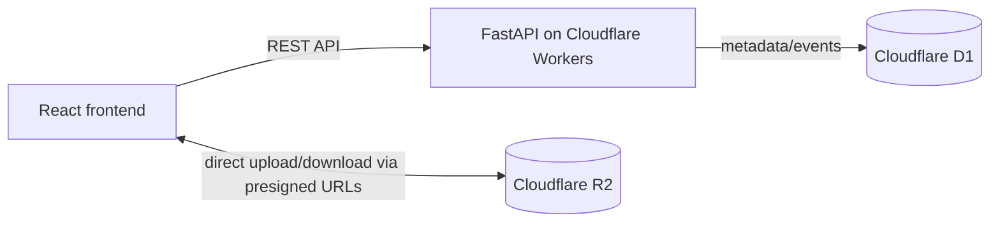

# CloudShare

A serverless file-sharing application with activity tracking. Upload a file, get a shareable link, recipients download without an account. Metadata and events are stored in Cloudflare D1; files in Cloudflare R2.

## Architecture



## Tech stack

- Frontend: React, TypeScript, Vite, Tailwind CSS, TanStack Query, React Router, Lucide.
- Backend: Python, FastAPI, Pydantic, HTTPX.
- Cloud: Cloudflare R2 (storage), D1 (SQL), Workers (runtime), Wrangler.

## Prerequisites

- Python 3.11+
- Node.js 20+
- uv (optional) / pip
- (For deploy) Wrangler CLI and a Cloudflare account

## Local setup

### Backend

```bash
cd backend
python -m venv .venv
source .venv/bin/activate
pip install -e ".[dev]"  # or pip install -r requirements; deps in pyproject
cp ../.env.example .env
PYTHONPATH=src .venv/bin/uvicorn src.app.main:app --reload --port 8000
```

Migrations apply automatically on startup (SQLite). If R2 credentials are not set, files are stored locally in `backend/uploads/` and served through the backend, so the full upload→share→download flow works out of the box.

### Frontend

```bash
cd frontend
npm install --include=dev
cp .env.example .env.local
npm run dev
```

Frontend runs on http://localhost:5173 and proxies /api to the backend.

## Environment variables

See `.env.example` (backend) and `frontend/.env.example`.

## Database

- Local: SQLite file `cloudshare.db` (auto-created).
- Production: Cloudflare D1. Create with `wrangler d1 create cloudshare-db`, update `database_id` in wrangler.toml, apply `cloudflare/migrations/0001_init.sql`.

## R2

Create a bucket `cloudshare-files`. Set CORS to allow PUT/GET from your frontend origin. Configure credentials via Wrangler secrets or env vars.

## Running tests

Backend:
```bash
cd backend
.venv/bin/python -m pytest -q
.venv/bin/ruff check .
.venv/bin/mypy app
```

Frontend:
```bash
cd frontend
npm test
npm run build
```

## Cloudflare deployment

```bash
cd backend
# create D1 + R2 first, update wrangler.toml
uvx --from workers-py pywrangler d1 execute cloudshare-db --file=../cloudflare/migrations/0001_init.sql
uvx --from workers-py pywrangler secret put R2_ACCOUNT_ID
uvx --from workers-py pywrangler secret put R2_ACCESS_KEY_ID
uvx --from workers-py pywrangler secret put R2_SECRET_ACCESS_KEY
uvx --from workers-py pywrangler deploy
```

Deploy frontend to Cloudflare Pages (or any static host) with `VITE_API_BASE_URL` pointing to the worker URL.

## Security considerations

- R2 credentials never exposed to browser; only short-lived presigned URLs.
- Share tokens are high-entropy, stored as SHA-256 hashes.
- Randomized R2 object keys; no public bucket access.
- Input validation, parameterized SQL, rate limiting (in-process).
- CORS restricted to configured origins.

## Download tracking semantics

See docs/architecture.md. Events are `verified` (server-side object checks), `client_reported` (browser completion reports), or `uncertain` (abandoned/expired sessions).

## Known limitations

- Rate limiting is in-process, not globally consistent across serverless instances.
- Presigned URLs remain usable until expiry after link revocation.
- Download completion is client-reported, not cryptographically verified.
- D1 binding requires Cloudflare account; local dev uses SQLite.

## Free-tier notes

Cloudflare Workers, D1, and R2 offer free tiers with daily request/storage limits. Verify current limits at https://developers.cloudflare.com before production use. Avoid exceeding free-tier quotas to prevent overage costs.